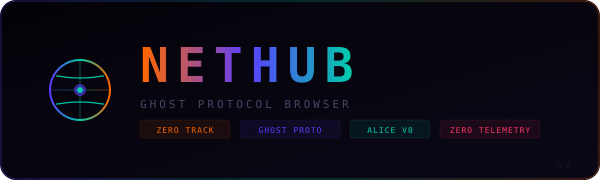

<p align="center">
  
</p>

<h1 align="center">NETHUB</h1>
<h3 align="center">Powered By NETRUNNER Engine</h3>

<p align="center">
  <strong>V0 Isolated Browser — Ghost Protocol — Zero Tracking — Zero Telemetry</strong>
</p>

<p align="center">
  
  
  
  
  
  
</p>

---

## What is NETHUB?

**NETHUB** is a privacy-first isolated browser built for the **ALICE** ecosystem, powered by the **NETRUNNER Engine**. It goes beyond what Chrome, Firefox or Brave offer by default — every layer is hardened for zero tracking, zero telemetry, and zero fingerprinting.

NETHUB is not a wrapper around a browser. It's a complete browsing stack: **Electron renderer + Ghost Protocol proxy + NETRUNNER search engine + real-time tracker blocking + canvas fingerprint spoofing + navigator hardening**.

## NETHUB vs Chrome

| Feature | Chrome | Brave | NETHUB |
|---|---|---|---|
| **WebRTC IP Leak** | Leaks by default | Blocks | Blocks + all UDP disabled |
| **Telemetry** | Sends to Google | Reduced | Zero — all disabled at binary level |
| **Tracker Blocking** | None built-in | Shield (EasyList) | 40+ tracker domains blocked at proxy |
| **Ad Blocking** | None | Brave Ads replacement | DOM removal + MutationObserver |
| **Fingerprint Protection** | None | Some | Canvas spoofing + navigator hardening |
| **User-Agent** | Fixed (real) | Fixed (real) | Rotating pool of 5 UAs per request |
| **Referer/Origin Headers** | Sent | Sent (configurable) | Stripped on every request |
| **Background Networking** | Pings Google | Pings Brave servers | Zero — all background disabled |
| **DNS Requests** | Via system DNS | Optional DoH | Via proxy — no direct DNS from browser |
| **HTTPS Enforcement** | Optional | HTTPS upgrade | Auto-upgrade all HTTP → HTTPS |
| **Search Engine** | Google | Brave Search | NETRUNNER Engine (privacy proxy) |
| **Permission Defaults** | Ask | Ask | Deny all (geolocation, media, etc.) |
| **Idle Detection API** | Enabled | Enabled | Disabled at binary level |
| **Bluetooth/USB/Serial** | Enabled | Enabled | Disabled at binary level |
| **Speech API** | Enabled | Enabled | Disabled |
| **Sync/Translate** | Google | Brave | Disabled |

## NETRUNNER Engine

The **NETRUNNER Engine** is the proxy + interception layer that makes NETHUB different from any Electron wrapper:

- **Ghost Protocol Proxy** — All traffic routed through a local proxy that rewrites URLs, strips tracking headers, rotates user agents, and enforces HTTPS
- **JS Interceptor** — Overrides `fetch()`, `XMLHttpRequest.open()`, `Element.setAttribute()`, `document.createElement()` and `HTMLScriptElement.src` to route all dynamic requests through the proxy
- **Canvas Fingerprint Spoofing** — Modifies `toDataURL()` and `toBlob()` output with per-session noise to defeat canvas fingerprinting
- **Navigator Hardening** — Reports generic `hardwareConcurrency`, `deviceMemory`, `platform`, `languages`, `plugins` values
- **Tracker Domain Kill** — 40+ advertising and analytics domains silently return 204 No Content
- **Ad Element Removal** — CSS selector-based ad removal + `MutationObserver` for dynamically injected ads
- **NETRUNNER Search** — DuckDuckGo results proxied and rebranded — zero direct connection to any search engine

## Ghost Protocol Stack

```
Layer 5 — PERMISSION    Deny geolocation/notifications/media/USB/HID/Serial/Idle
Layer 4 — RENDERER      Sandbox + contextIsolation + no nodeIntegration + no WebGL
Layer 3 — NAVIGATOR     Canvas spoof + fake hwConcurrency/deviceMemory/platform/plugins
Layer 2 — PROXY         URL rewrite + HTTPS enforce + tracker kill + UA rotation
Layer 1 — NETWORK       WebRTC disabled + no background net + no pings + no sync
Layer 0 — BINARY        21 Chromium flags disabled at electron binary level
```

## Features

| Feature | Status |
|---|---|
| **WebRTC Disabled** | All WebRTC APIs blocked — no IP leak via STUN/TURN |
| **Session Isolation** | Each session runs sandboxed with contextIsolation |
| **Proxy Engine** | All traffic routed through ghost proxy — no direct connections |
| **Rotating User-Agent** | Random UA per request from 5 curated browser profiles |
| **Canvas Spoofing** | `toDataURL()` + `toBlob()` noise injection per session |
| **Navigator Hardened** | Generic hardware/platform/language/plugin fingerprint |
| **Tracker Blocking** | 40+ ad/analytics domains silently killed (204) |
| **Ad Removal** | DOM selector removal + MutationObserver for dynamic ads |
| **HTTPS Enforcement** | All HTTP automatically upgraded to HTTPS |
| **No Fingerprinting** | WebGL disabled, spellcheck off, no client data headers |
| **DNT / Sec-GPC** | Do Not Track + Global Privacy Control on every request |
| **No Referer / Origin** | Headers stripped on all outbound requests |
| **21 Chrome Flags** | Disabled: sync, translate, speech, bluetooth, USB, HID, serial, idle |
| **Single Instance** | Lock ensures only one NETHUB process runs |
| **Permission Deny-All** | Geolocation, notifications, media, MIDI, idle — all denied |
| **Autoplay Blocked** | Media requires user gesture |
| **NETRUNNER Search** | Privacy search with zero direct engine contact |

## Architecture

```
┌─────────────────────────────────────────────────────────────┐
│                    NETHUB — V0 BROWSER                       │
│                  Powered By NETRUNNER Engine                  │
│                                                               │
│  ┌────────────┐    ┌──────────────┐    ┌─────────────────┐  │
│  │  Electron   │───▶│    Ghost      │───▶│  NETRUNNER      │  │
│  │  Renderer   │    │  Protocol    │    │  Proxy Engine   │  │
│  │  (Sandbox)  │    │  (5 layers)  │    │  (URL rewrite)  │  │
│  └──────┬─────┘    └──────┬───────┘    └───────┬─────────┘  │
│         │                  │                     │            │
│  ┌──────▼─────┐    ┌──────▼───────┐    ┌───────▼─────────┐  │
│  │ Permission  │    │   Header     │    │  Tracker Kill   │  │
│  │ Deny-All   │    │  Stripper    │    │  40+ domains    │  │
│  └────────────┘    └──────────────┘    └─────────────────┘  │
│         │                  │                     │            │
│  ┌──────▼─────┐    ┌──────▼───────┐    ┌───────▼─────────┐  │
│  │  Canvas     │    │  Navigator   │    │   UA Rotation   │  │
│  │  Spoofing   │    │  Hardening   │    │   5 profiles    │  │
│  └────────────┘    └──────────────┘    └─────────────────┘  │
│         │                  │                     │            │
│  ┌──────▼─────┐    ┌──────▼───────┐    ┌───────▼─────────┐  │
│  │  Ad Block   │    │  JS Intercept│    │  HTTPS Enforce  │  │
│  │  DOM + Mut  │    │  fetch/XHR   │    │  Auto upgrade   │  │
│  └────────────┘    └──────────────┘    └─────────────────┘  │
└─────────────────────────────────────────────────────────────┘
```

## Part of the ALICE Ecosystem

NETHUB is one module in the **A.L.I.C.E** (Autonomous Linked Intelligence for Comprehensive Execution) framework.

- [A.L.I.C.E](https://github.com/VZero911/A.L.I.C.E) — Core framework
- [THESEED](https://github.com/VZero911/THESEED) — L0 blockchain engine
- [ALICEHUB](https://github.com/VZero911/ALICEHUB) — Centralized hub
- [GAMEHUB](https://github.com/VZero911/GAMEHUB) — Game hub & launcher
- **NETHUB** — Isolated browser (this repo)

## Requirements

- Node.js 18+
- Electron 33+
- ALICE backend services

## Usage

```bash
npm install
npm start
# or open a URL directly:
npm start -- https://example.com
```

---

<p align="center">
  <sub>Built by <strong>V0</strong> — <a href="https://github.com/VZero911">@VZero911</a></sub>
</p>

---

> **ANTI-NETRUNNER** — This repository uses character-level code hashing for intellectual property protection. Full source code is available on request with identity verification. Contact: [VZero911](https://github.com/VZero911)
